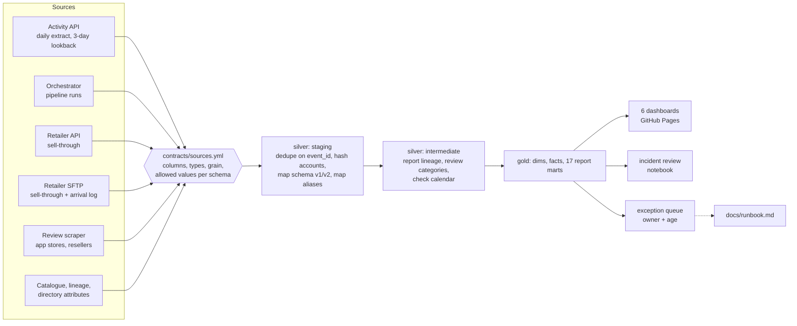

# Data-product observability: adoption, reliability and customer feedback

[](https://github.com/Saigwe/data-product-observability/actions/workflows/ci.yml)
[](https://saigwe.github.io/data-product-observability/)

**Live dashboards: [saigwe.github.io/data-product-observability](https://saigwe.github.io/data-product-observability/)**

A monitoring layer for a company's own data products and its customers' voice. It answers three questions:
which reports do people actually use, was the data behind them fresh when they looked, and what are customers saying
about the app and the products? Usage changes priorities: a missed SLA on the most-used report is an incident, the same
miss on a report nobody opens is a backlog item. Review volume changes conclusions: a rating drop on 281 reviews is a
regression, the same drop on three reviews is a weak signal.

Built end to end: a seeded synthetic generator for API-style activity events, pipeline runs, two sell-through feeds and
reviews; source contracts; a dbt warehouse on DuckDB; six web dashboards; a reproducible incident review; a runbook,
process diagram, metric registry and DAX measure spec. The scenario is modelled on BI-usage monitoring, data-reliability
and app-review analytics work in consumer electronics.

**Everything here is invented.** Brightwater Electronics, its reports, accounts, retailers, products, competitors and
every number come from `generator/simulate.py`. SLA and adoption metrics are simulated; the results are demo results, not
any company's figures. No real user appears anywhere: accounts are generated, hashed in staging and never reach gold.

## The business

Brightwater Electronics publishes 26 reports on a BI platform to about 450 employees. Ten datasets feed them, refreshed
by an orchestrator. Sell-through from eight retailers arrives twice, by API and by nightly SFTP file. The platform's
activity API is extracted daily with a three-day lookback, so events arrive more than once and some arrive late. On
15 September the API's schema changed (`ViewReport` became `ReportViewed`). Customers review the companion app in two
stores and the products on three resellers.

## What the reports find

The generator plants known problems; `tests/test_planted_answers.py` checks the marts find each one, and only those.
From the current build ([analysis/incident_review.md](analysis/incident_review.md), regenerated on every build):

| Finding | Where |
|---|---|
| **The incident.** The Executive Sales Scorecard is the most-used report (271 viewers a week). Its dataset missed 9 of 90 freshness checks, all in October: 90.0% compliance and 584 views on stale data. Four other reports miss the same checks, but usage ranks it first | Reliability |
| **Root cause.** Every miss follows a late SFTP file from the largest retailer (2.3 to 8.0 hours after its 04:00 due time); the sales refresh waits for all files | Reliability |
| **Actionable.** App 5.2.0 on Android: 281 reviews at 2.57 stars, 0.99 below 5.1.0 (95% interval -1.24 to -0.74); 52% mention pairing. 5.2.1 recovers to 3.71 | App feedback |
| **Weak signal.** Arc Speaker Mini in Japan fell to 1.67 stars in the week of 9 Nov, on three reviews. Shrunk toward its baseline of 3.87 it is 3.58: watch, do not escalate | Product ratings |
| A new complaint (a subscription plan) appears from 5.1.0; no category rule covers it, so it shows as growth in "uncategorised" rather than disappearing into "other" | App feedback |
| One service account exports a report overnight; 69% of that report's views were automated. Metric v2 excludes service accounts | Adoption |
| A filter on the old activity name would show zero views after the API schema change; staging maps both versions (63,590 views kept) | Data checks |
| Sell-through exceptions: one retailer's API double-counted three days (+100%), another's SFTP file never arrived for one day. Four exceptions, 11,150 units at stake | Reliability |

## How it fits together



```
generator/simulate.py  ->  data/raw/*.parquet (12 tables + answer key)
contracts/sources.yml  ->  columns, types, grain and allowed values per API schema version (tests/test_contracts.py)
dbt/ (DuckDB)          ->  silver: staging, intermediate, metric registry and rule seeds
                       ->  gold:   dims, three facts, 17 report marts (37 models, 31 tests)
dashboards/            ->  export.py -> data.json -> build.py -> 6 static pages (ECharts), GitHub Pages
analysis/              ->  incident_review.py (notebook) -> incident_review.md, fingerprint.py
bi/                    ->  DAX measures and report spec
docs/                  ->  metric dictionary, design decisions, runbook, demo script
```

Grain of the core facts:

| Model | Grain |
|---|---|
| `fct_report_activity` | one activity event (deduplicated), with hashed account, stable report key, member or service |
| `fct_pipeline_runs` | one orchestrator run |
| `fct_reviews` | one review, with one category and a mapped product or none |
| `rpt_freshness_checks` | dataset x daily due time |
| `rpt_adoption_weekly` | report x week (distinct viewers, repeat viewers, member views) |

## What is tested

- **Counted once.** Each event is counted once however many extracts delivered it; late events are picked up by the lookback.
- **Viewers are not views.** Viewers are distinct accounts and are never summed across reports or weeks; views are events.
  A test fails if platform viewers equal the sum of report viewers.
- **Stable identifiers.** A report that moved workspace keeps its history under one key; a renamed report keeps its by ID;
  a deleted report leaves the coverage denominator.
- **Schema change.** Both activity schemas map to one activity type; a test fails if views drop at the change.
- **Personal data.** Account names are hashed with a salt in staging; reviewer handles are dropped. A test fails if a column
  named like an identifier, or an `@`, reaches gold. Department groups under five viewers are suppressed.
- **Sparse reviews.** A rating is always shown with its review count; fewer than 30 reviews is never an incident.
- **Reconciliation.** API and SFTP totals in the reconciliation equal each source's totals.
- **Source contracts.** Every raw file is checked for columns, types, grain and allowed values per schema version.
- **Rebuild consistency.** CI regenerates from the same seed, rebuilds, and compares a fingerprint of every gold mart.

## Run it

```bash
pip install -r requirements.txt
make all        # generate, dbt build, dashboards and the incident review (about a minute)
make rebuild    # regenerate and rebuild: every gold mart must be identical
make test       # pytest against the built warehouse
make serve      # dashboards on http://localhost:8000
```

On Windows without `make`, run the commands in the `Makefile` in order.

Demo assumptions (suppression threshold, reconciliation tolerance, rating shrinkage and signal thresholds) are dbt vars
in `dbt/dbt_project.yml`; change one and rebuild to see its effect.

## Licence

MIT. Synthetic data only.
